<!-- ============ Bloom Header (live weather in Wuhan · day / night follows your theme) ============ -->

  <picture>
    <source media="(prefers-color-scheme: dark)" srcset="header-night.svg" />
    
  </picture>

### Hi, I'm Aurora 👋

A student working on **computer vision** and **embedded systems** — currently building an
image-based fruit quality inspection system, from the camera pipeline up to the board it runs on.

<!-- ============ Tech Garden ============ -->

      
 
      
 
      
 
      
 
      

🌱 &nbsp;<b>Field guide</b> — open to read what every chip actually is

 

 
 
 
 
 

 

<!-- ============ Stats ============ -->

<picture>
  <source media="(prefers-color-scheme: dark)" srcset="streak-night.svg" />
  
</picture>

 

<!-- ============ Snake ============ -->

  <picture>
    <source media="(prefers-color-scheme: dark)" srcset="https://raw.githubusercontent.com/ythorin17/ythorin17/output/github-contribution-grid-snake-dark.svg" />
    
  </picture>

<!-- ============ Footer (a cat lives here) ============ -->

  <picture>
    <source media="(prefers-color-scheme: dark)" srcset="garden-footer-night.svg" />
    
  </picture>

The sky above follows the real forecast in Wuhan and the garden follows the season — powered by <a href="https://github.com/yuki4266/living-scene">living-scene</a>.

